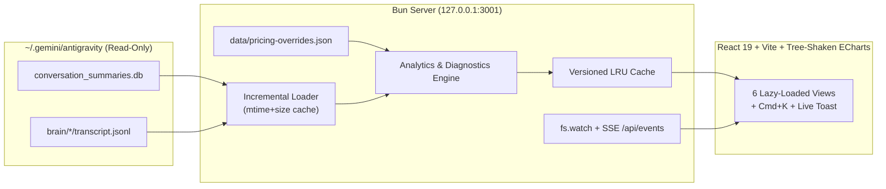

> [!WARNING]
> **AI Vibe-Coded Project:** This entire repository was vibe-coded with AI. While it includes automated unit tests, TypeScript checks, and security hardening (strict read-only data access, XSS escaping, localhost-only binding, and CSP), please review the code before relying on it for billing, compliance, or anything mission-critical.

# Antigravity Token Usage & API Cost Dashboard


A local, real-time analytics dashboard that reads your `~/.gemini/antigravity` transcripts and SQLite summaries **strictly read-only** to visualize token usage, prompt-cache savings, multi-agent/swarm timelines, turn latencies, and estimated public API costs.

---

## Features

- **Overview & Cost Flow**:
  - 6 hero KPI cards (Estimated API Spend & 30-day projection, Cache Savings & hit ratio, Token mix, Conversations & Subagents, Avg Cost/Chat & /Prompt, Active Days & Streak).
  - **V2/V3 Intelligence & Fun Insights**: Subscription ROI multiplier, Active Agent Time (`$/hr`), Cache-Miss Waste, Error Burn, Books Read / Novels Written / Est. Lines of Code, Coding Persona, Peak Day record, Week-over-Week velocity deltas, and Workspace Efficiency Grade (`S`–`D`).
  - Interactive **Apache ECharts** Daily / Hourly / Cumulative time-series with draggable `dataZoom` brush slider and 7-day moving average.
  - **Cost Flow Sankey Diagram** (`Projects → Models → Uncached Input / Cache Read / Output`).
- **Projects**:
  - **Interactive Spend Treemap** (`Project → Conversation` zoomable hierarchy, toggleable by Cost/Tokens and Cache Hit coloring).
  - Direct vs. Rolled-Up (including subagents) toggle, sortable workspace table with Efficiency Grades, active time, cache-miss spikes, error counts, and expandable project drill-down.
- **Conversations & Deep Inspector**:
  - Expandable parent-child conversation & subagent/swarm hierarchy tree.
  - **Deep Conversation Inspector**: Context Window Growth chart with `>200K` threshold line and Cache-Miss spike markers, Per-Step Cost / Output / Latency chart, Subagent sidebar, step-by-step execution trace, and **per-conversation manual model tagging** for older untagged transcripts.
- **Swarms & Agents**:
  - **Interactive Swarm & Subagent Gantt Waterfall Timeline** showing coordinator + parallel worker lifespans overlapping in real time.
  - Spend & runs leaderboard by agent role (`@research`, `@browser`, `@verifier`, `@backend`, etc.) and parent-vs-child cost breakdown.
- **Models & Pricing**:
  - **Subscription ROI & Value Calculator** (`$20 / $100 / $200/mo` presets or custom plan).
  - **What-If Public API Cost Simulator** comparing your exact token workload across Gemini 2.5 Pro/Flash, Claude Opus/Sonnet 4.5, GPT-5, GPT-4.1, and DeepSeek R1.
  - **Editable Rate Card** with configurable **Fallback Model** (default: **Gemini 3.8 Flash** for older pre-Nov-21 untagged transcripts) and optional **`>200K` long-context tiered pricing** multipliers.
- **Efficiency Lab**:
  - **Efficiency Score (0–100) & Grade** with actionable optimization tips.
  - **Cache-Miss & Context Bloat Detector**, **Active Time & Latency** (`median / p95`, `out tok/s`), and **Error & Retry Cost Tracker**.
  - **Context Size vs. Turn Cost / Output Scatter Plot** (click any outlier to inspect).
  - **Daily Activity Calendar Heatmap**, **7×24 Day×Hour Matrix**, **Top Tools**, **Top Agent Tool-Chain Workflows (Bigrams)**, and **Top 25 Most Expensive Turns**.
- **Power-User UX**:
  - Real-time file watching + Server-Sent Events (`/api/events`) with live token-delta toast notifications.
  - `Cmd/Ctrl+K` Command Palette for instant jump across tabs, projects, conversations, and subagents.
  - Formula-safe CSV & JSON exports, plus persistent Dark/Light theme toggle.

---

## Quick Start

Requires [Bun](https://bun.sh) (`>= 1.2`).

```bash
# Install dependencies
bun install

# Development mode (Bun API on 127.0.0.1:3001 + Vite HMR on 127.0.0.1:5173)
bun run dev

# Production build & single-server start (http://127.0.0.1:3001)
bun run build
bun run start

# Run automated tests (unit + security suite)
bun test
```

### Environment Variables

| Variable | Default | Description |
|---|---|---|
| `PORT` | `3001` | HTTP server port |
| `HOST` | `127.0.0.1` | Bind address (kept localhost-only by default for privacy) |
| `ANTIGRAVITY_DIR` | `~/.gemini/antigravity` | Path to Antigravity data directory |

---

## Architecture



### Verified Token Math
Antigravity's `transcript.jsonl` records `input_tokens` (uncached fresh input) and `cache_read_tokens` (separate cached input):
- `totalContext = input_tokens + cache_read_tokens`
- `totalTokens = input_tokens + cache_read_tokens + output_tokens`
- `cacheHitRatio = cache_read_tokens / totalContext`
- `apiCost = (input_tokens * inputRate + cache_read_tokens * cacheReadRate + output_tokens * outputRate) / 1_000_000`
- `cacheSavings = (cache_read_tokens * (inputRate - cacheReadRate)) / 1_000_000`

---

## Security & Privacy Guarantees

- **Strictly Read-Only Data Access**: Opens `conversation_summaries.db` with `{ readonly: true }` and never writes inside `~/.gemini/antigravity`. User pricing overrides live locally inside `data/pricing-overrides.json` (git-ignored).
- **Localhost-Only by Default**: Binds to `127.0.0.1`, restricts CORS to `http://localhost:*` / `http://127.0.0.1:*`, and rejects cross-origin `PUT`/`POST` mutations (`403`) to prevent CSRF.
- **XSS & Injection Defense**:
  - Every ECharts HTML tooltip formatter escapes dynamic strings via `escapeHtml()` and validates CSS colors via `sanitizeCssColor()`.
  - Strict HTTP security headers (`Content-Security-Policy` with `script-src 'self'`, `X-Frame-Options: DENY`, `X-Content-Type-Options: nosniff`, `Referrer-Policy: no-referrer`).
  - JSON body size cap (`256 KB`), prototype-pollution key filtering (`__proto__`, `constructor`, `prototype`), symlink-safe `realpathSync` static serving, and CSV formula-injection neutralization.

---

## API Reference

| Endpoint | Method | Description |
|---|---|---|
| `/api/dashboard` | `GET` | Aggregated KPIs, series, heatmaps, Sankey, scatter, swarms, projects, conversations (`startDate`, `endDate`, `projectId`, `model`, `includeSubagents`, `search`) |
| `/api/conversations/:id` | `GET` | Full step-by-step trace, costs, latencies, cache-miss flags, subagents, and ancestor breadcrumbs |
| `/api/conversations/:id/model-override` | `PUT` | Persists a manual model tag `{ "modelId": "..." \| null }` for an untagged conversation |
| `/api/pricing` | `GET` / `PUT` | Read or save pricing rates, fallback model, `>200K` tier rules, and subscription price |
| `/api/pricing/reset` | `POST` | Resets pricing overrides back to built-in defaults |
| `/api/events` | `GET` | Server-Sent Events stream (`connected`, `update`, and `: ping` heartbeats) |
